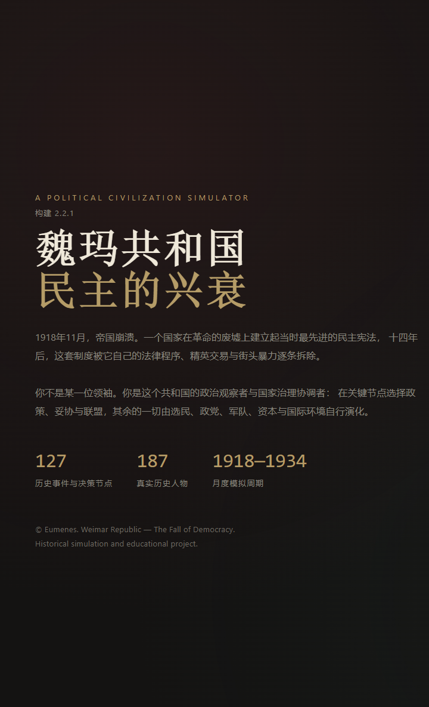
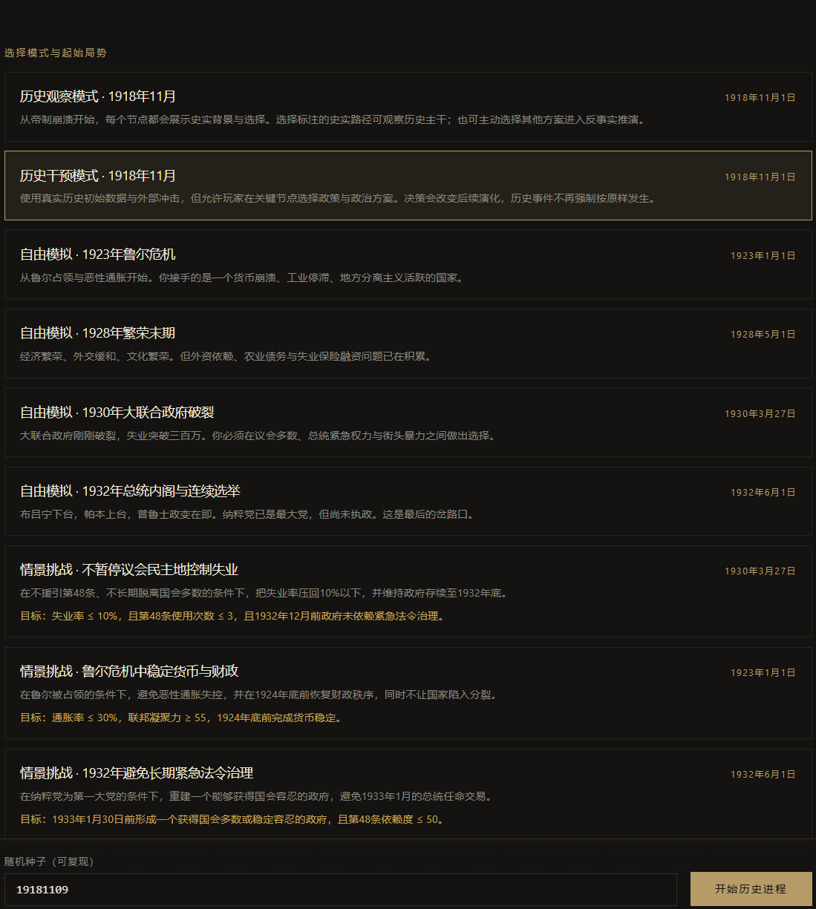
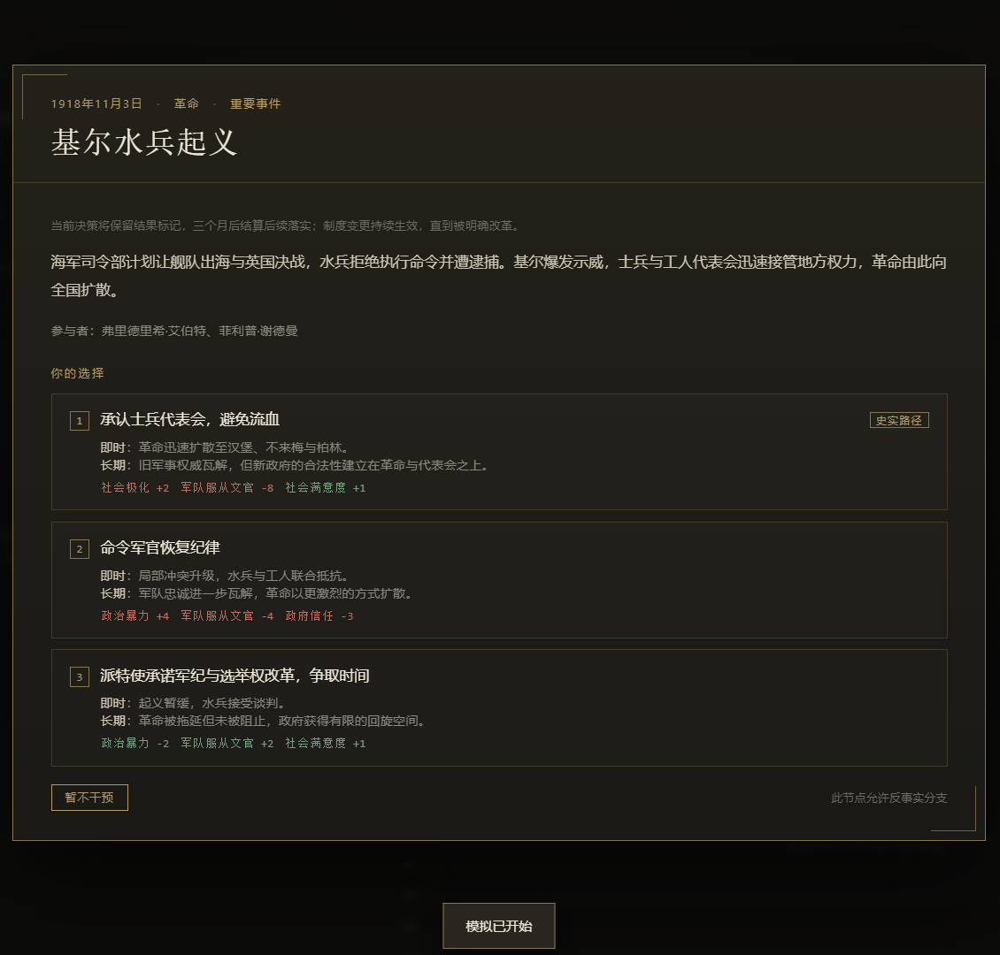
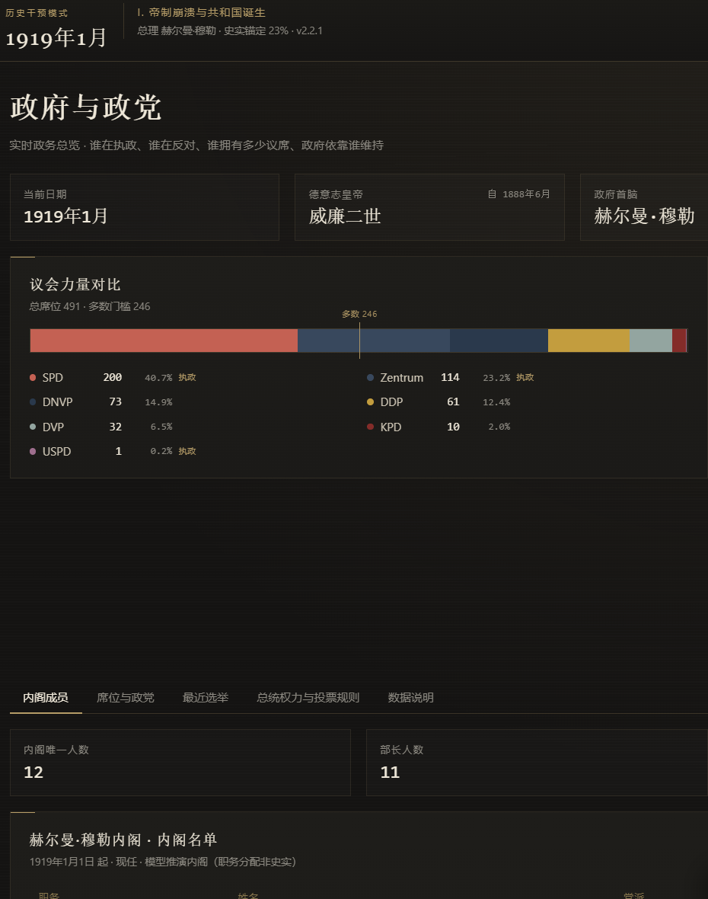
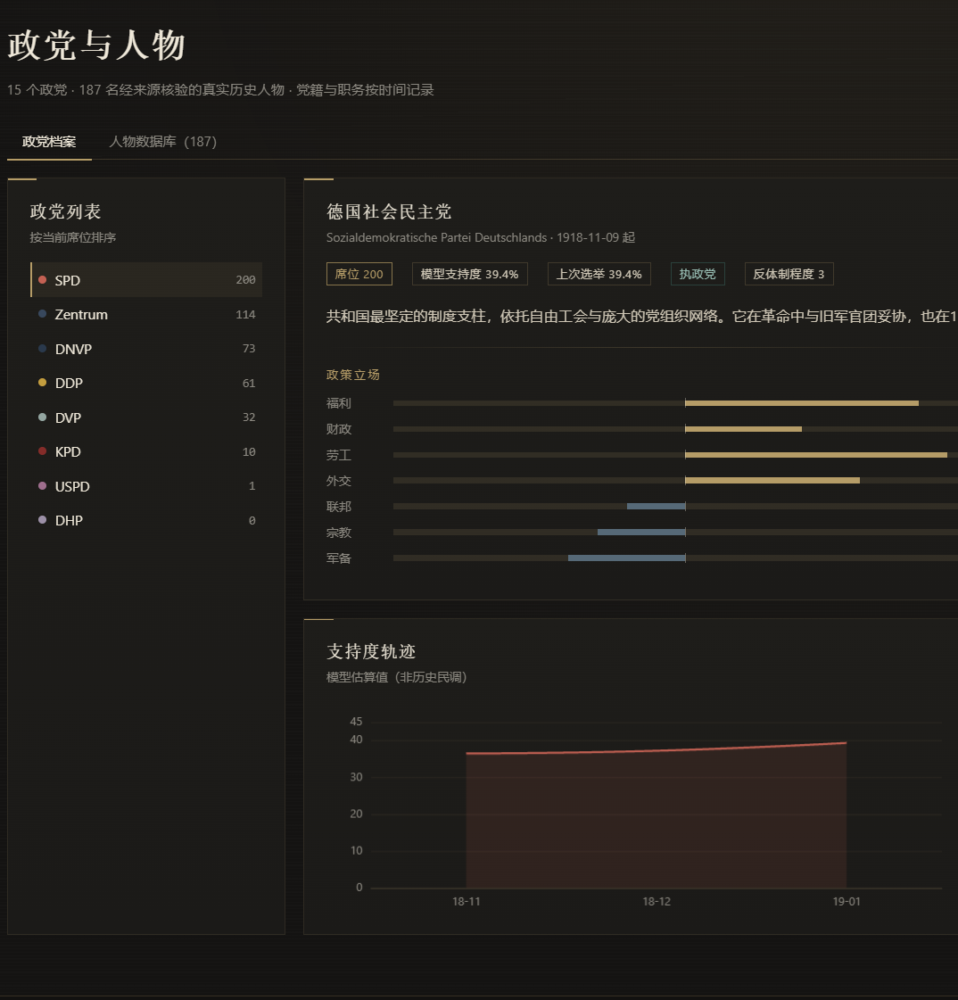
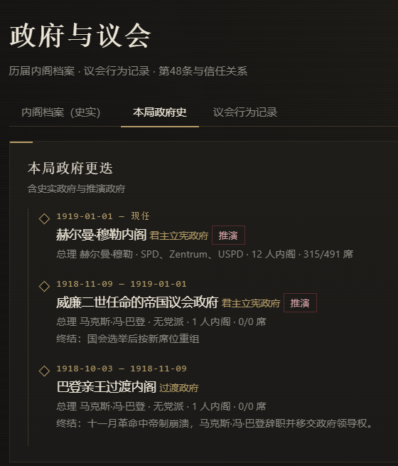
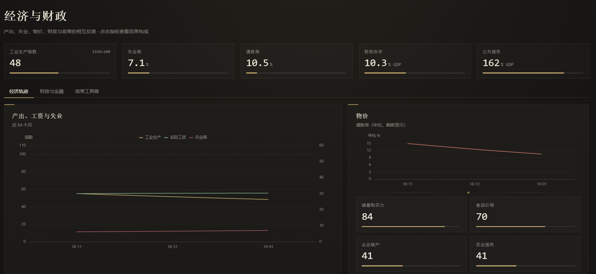
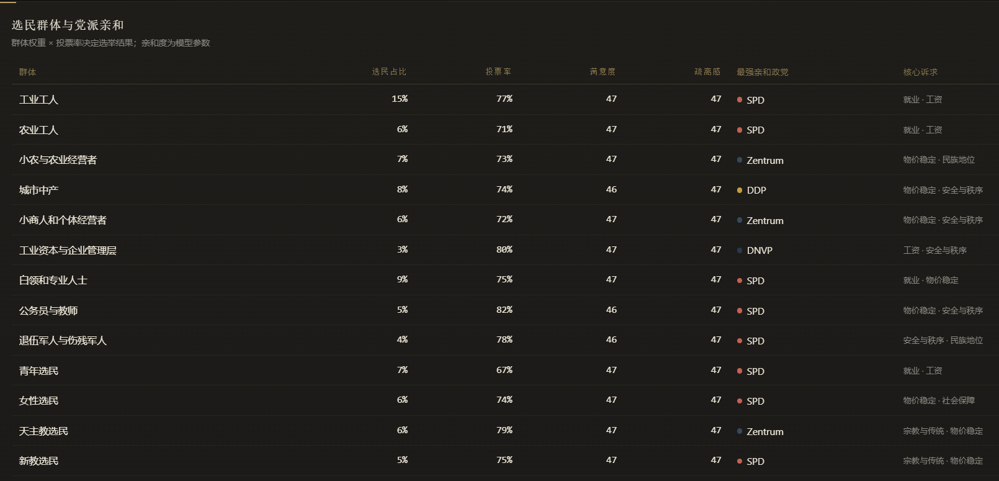
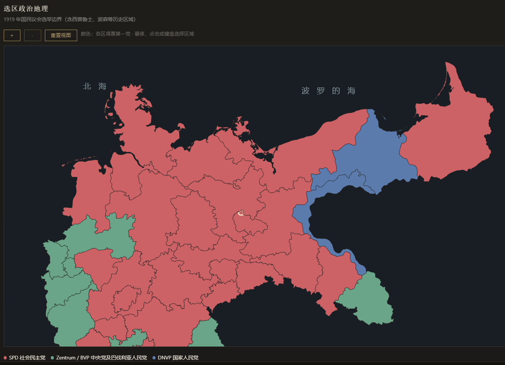

# 魏玛共和国：民主的兴衰

**Weimar Republic — The Fall of Democracy**
政治文明演化模拟器 · V2.2.1
© Eumenes

一套以 1918/1919—1934 年魏玛共和国为核心对象的政治、经济、社会、外交与制度演化模拟器。
玩家不直接操作数值，而是在关键历史节点选择政策、妥协、组阁与危机应对方案；
政党、选民群体、军队、资本与国际环境按各自的约束自行演化。

---

当前玩家反馈修正见 [V2.2.1_PLAYER_FEEDBACK](docs/V2.2.1_PLAYER_FEEDBACK.md)：当前政府事件、选举组阁和持续政策传导。

## 界面预览

以下为游戏实际界面截图（V2.2.1）。

| 标题页 | 模式与起始局势 |
|:--:|:--:|
|  |  |

| 事件决策：基尔水兵起义 | 政府与政党 |
|:--:|:--:|
|  |  |

| 政党与人物 | 政府与议会 |
|:--:|:--:|
|  |  |

| 经济与财政 | 选民群体与党派亲和 |
|:--:|:--:|
|  |  |

| 选区政治地理 | |
|:--:|:--:|
|  | |

## V2.2 更新

完整修改说明见 [V2.2_CHANGELOG](docs/V2.2_CHANGELOG.md)，分支覆盖见 [V2.2_BRANCH_AUDIT](docs/V2.2_BRANCH_AUDIT.json)。新增持续决策后果、结果驱动事件链、统一法令与政党状态、JSON 导入，以及窄屏布局。

## 快速开始

```bash
cd weimar-republic-simulator
npm install
npm run dev        # http://localhost:5183
npm run build      # 生产构建到 dist/
npm test           # 113 项数据完整性与模拟回归测试
```

本地优先、离线可运行。除构建工具外无运行时网络依赖，不加载任何外部字体、图片或统计接口。

---

## 两种历史关系，必须分清

| 类型 | 含义 | 界面标识 |
|---|---|---|
| 史实数据 | 选举结果、内阁名单、人物生平、条约节点 | 「史实」「史实记录」「historical_secondary」 |
| 模型推演 | 支持度、制度指数、经济变量、推演选举、推演内阁 | 「模型估算」「推演」「simulation_derived」 |

零偏离的历史观察模式原样展示史实选举结果，并明确说明未计模型贡献。

**干预模式史实锚定机制**：在干预模式下，选举结果会按 `史实锚定强度` 向史料基线加权
（初始 85%—92%）。玩家每做出一次偏离史实的决策，锚定强度下降；偏离足够大时，
选举完全由模型决定。顶栏实时显示当前锚定强度，选举页显示同一数值。
这条机制让"照着历史走"与"真的改变历史"成为两种可区分、可解释的状态，
而不是让模型悄悄把结果拉回史实。

**选择如何改变历史**：每个事件至少 3 个选项，史实路径固定标注在第一项。
非史实选择会累积偏离度、改变经济与社会状态，并可能让后续历史事件因前置条件不成立而**不再发生**
（日志会记录「历史条件不成立：……」）。事件链（如「国会纵火案 → 取消共产党议席 → 授权法」）
会随之整条取消。实测三种选择策略会得到三套不同的选举结果、内阁序列与结局。

---

## 页面结构

| 页面 | 作用 |
|---|---|
| 国家总览 | 当前政府、议会构成、经济轨迹、月度要闻、结构指标 |
| **政府与政党** | 实时政务总览：国家元首、政府首脑、内阁名单、席位算术、多数门槛、投票规则、第48条记录 |
| 选举中心 | 选举详情、历次选举、总统选举与公投；史实与推演结果分开保存 |
| 政党与人物 | 15 个政党档案 + 187 名经来源核验的真实历史人物数据库 |
| 政府与议会 | 历届内阁档案（1918—1934 全部 23 届）、本局政府史、议会行为记录 |
| 经济与财政 | 产出/失业/物价轨迹、财政与金融、18 项政策工具（含代价） |
| 社会与秩序 | 16 个选民群体、极化与暴力、社会组织与准军事团体 |
| 外交与国际 | 双边关系、赔款与贷款、关键条约节点、国际行为体 |
| 历史地图 | 34 个选区的示意政治地理（非精确边界） |
| 事件档案 | 127 个历史节点与条件事件，含史实结果与本局决策对照 |
| 结局报告 | 结局判定、制度/经济/外交评估、选举年表、关键转折、决策记录 |

---

## 操作

- `▶ 月` 推进一个月；`1× / 4× / 12×` 自动推进；`暂停` 停止。
- 出现事件卡时必须做出选择，或点「暂不干预」按史实路径处理。
- `存档` 写入浏览器 IndexedDB；开始界面可载入历史存档。
- 结局报告页可导出 JSON 存档，开始界面可导入；结束后自动打开报告并冻结状态。
- 每个已触发事件都交由玩家选择；只有主动选择“暂不干预”才委托系统处理。
- 每次选择保留结果标记与持续反馈，三个月后结算落实；具体制度结果参与后续事件判定。

---

## 目录

```
weimar-republic-simulator/
├── src/
│   ├── data/            数据层（政党、人物、内阁、选举、事件、政策、选区、世界）
│   │   └── events/      按时期分文件的历史事件与条件事件
│   ├── simulation/
│   │   ├── engine/      状态、日期、随机数、月度推进、结局判定
│   │   ├── economy/     经济与财政模型
│   │   ├── society/     社会结构与情绪
│   │   ├── politics/    制度变量
│   │   ├── elections/   投票效用、席位分配、组阁、选举执行
│   │   ├── diplomacy/   外交环境
│   │   ├── events/      事件触发与效果结算
│   │   └── explainability/ 因果解释
│   ├── pages/           11 个页面
│   ├── components/      UI 组件与图表封装
│   ├── store/           Zustand 状态
│   ├── persistence/     IndexedDB 存档
│   └── utils/           派生计算与标签
├── tests/               113 项测试
├── docs/                模型说明、数据字典、来源清单、验收自检
└── scripts/             基线推演与截图脚本
```

---

## 数据边界（必须知道）

1. **人物**：全部为真实历史人物，共 187 名。不编造姓名、职务或党籍。生日无法确证到日时只写年份。
2. **图片**：不打包任何肖像、海报或档案扫描件。人物卡使用中性剪影，并注明"无授权肖像"。
3. **选举**：得票率与席位为公开汇总资料的四舍五入值。1919 年存在 421/423 席、SPD 163/165 席的口径差异，
   本项目采用 423 席口径并在数据与界面中保留说明，不做静默拼接。
4. **内阁**：覆盖主要职务（总理、副总理、外交、内政、财政、经济、劳工、司法、国防、农业等）。
   未录入的次要部长不虚构补全，界面注明"待档案逐项核验"。
5. **模型参数**：选民群体权重、党派亲和度、经济弹性、制度反馈系数均为研究型参数，
   用于复现魏玛的政治结构，**不是史料统计值**。
6. **已知校准局限**：见 `docs/SIMULATION_MODEL.md` 最后一节。模型能复现 1919—1933 年九次国会选举的
   得票结构（多数政党误差 ≤ 2.5 个百分点）与大萧条的定性走势，但失业率峰值（模型约 26%，史料约 30%）
   与 1934 年的复苏幅度仍偏低。

---

## 版权与来源

历史事实的整理参考德国联邦议院、德国历史博物馆 LeMO、德国联邦档案馆、GHDI、USHMM、
Konrad-Adenauer-Stiftung 与德国议会人物数据库等公开来源，逐条列于 `docs/HISTORICAL_SOURCES.md`，
并在数据字段 `source_ids` 与界面中标注。本项目不复制上述来源的受版权保护文本或图像。

© Eumenes — Weimar Republic: The Fall of Democracy.

完整的创作与知识产权声明见 [创作声明与知识产权声明](docs/CREATOR_STATEMENT.md)。
